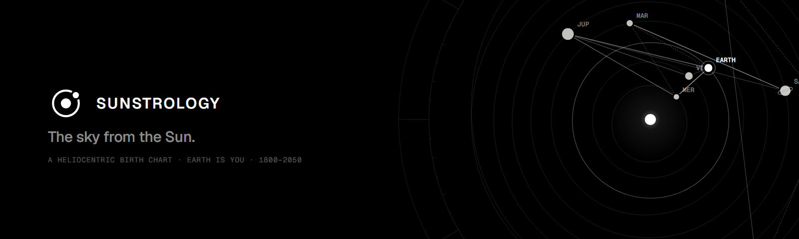

# Sunstrology

**The sky from the Sun.** A heliocentric birth chart by Kyler Simzer: the solar system at any moment from 1800 to 2050, computed as seen from the Sun, with Earth as you. Live at [sunstrology.com](https://sunstrology.com).

Your sign is Earth's **station**: one of twelve 30° sectors of its orbit, named for the Sun's own anatomy, from Core to Heliopause. No retrogrades, no houses, no borrowed zodiac. From the Sun, nothing ever moves backward.

The astronomy is real orbital mechanics (JPL approximate Keplerian elements, J2000 plus rates, solved with Kepler's equation; the Moon and moons from Meeus). The stations, patterns and readings are an invented symbolic layer built on that geometry, and the app keeps the two apart.

## What it does

- **Today:** a daily solar weather report. Today's sky against your birth sky, Earth's station now, the Moon, and what's coming up.
- **Your birth chart:** your station, the shape your sky made, and a reading.
- **Pair:** two skies overlaid, with a resonance score and every line between your worlds and theirs.
- **Telescope:** the same sky in 3D that you can fly through, with Ride Earth and Stand on the Sun.
- **Figures:** every value, computed: distance travelled, orbits, pulls, returns, cycles.
- **Oracle:** clean data plus an editable prompt for a written reading from any AI.
- **Poster:** your sky as a black or paper print.

Plus comets, asteroids, moons and the Voyagers; a time bar to play any span from 1800 to 2050; zoom, pan and hover info everywhere; and share links. It works on phones and desktop. People are saved on your device only: nothing about your birthday leaves your browser.

The original v1 almanac is still online at [sunstrology.com/classic](https://sunstrology.com/classic/).

## Run it locally

```bash
python tools/serve.py
```

Then open http://localhost:5173/web/. It's plain HTML, CSS and JavaScript modules with no build step. The Telescope loads three.js from a CDN the first time you open it.

## Layout

| Path | What |
|---|---|
| `web/` | The site (Netlify publishes this folder, see `netlify.toml`) |
| `web/js/astro.js` | The engine: orbits, aspects, patterns, the Moon. Maths only. |
| `web/js/objects.js` | Comets, asteroids, spacecraft, moons |
| `web/js/meaning.js` | The symbolic layer: stations, readings, weather, prompts |
| `web/classic/` | v1, unchanged |
| `design/` | The brand: the mark, banners and loops (`design/final`), built by `node design/build-brand.mjs` |
| `CONCEPT.md` | What v2 changed and what's next |

## Accuracy

Planetary positions come from JPL's approximate Keplerian elements, valid roughly 1800–2050. Lunations follow Meeus. Comets and asteroids are two-body tracks from epoch elements. This is an almanac and a visual instrument, not an ephemeris of record: for mission-grade precision, use JPL Horizons.

## License

MIT (see `LICENSE.txt`). If you use this in a commercial product or paid project, please include a visible credit: **"Sunstrology by Kyler Simzer"** (a request, not a licence requirement; see `NOTICE.txt`).

Contact: weworkfortheo@gmail.com · [kylersimzer.com](https://kylersimzer.com)
